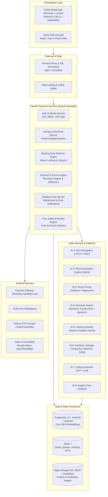
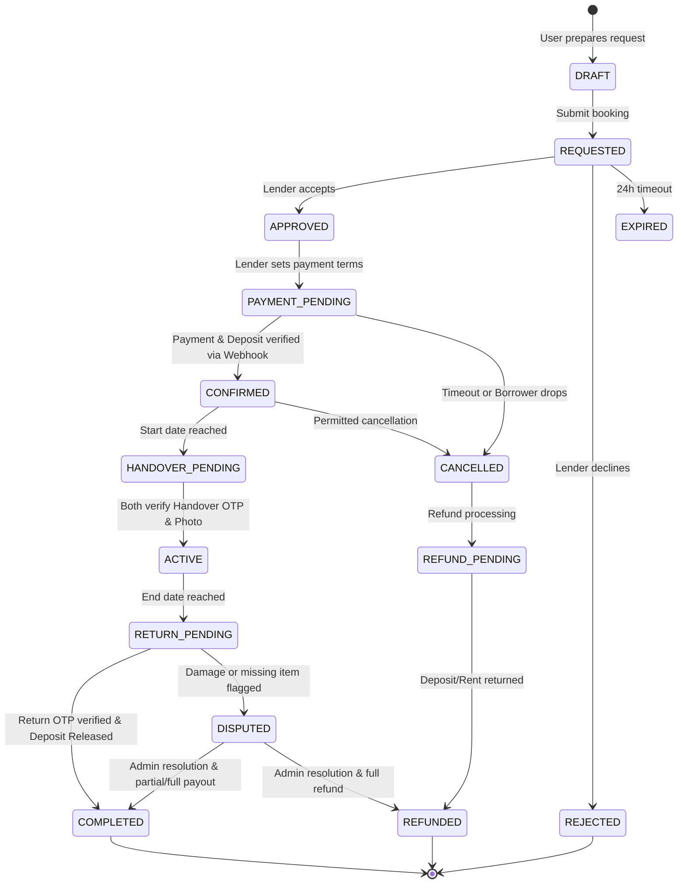
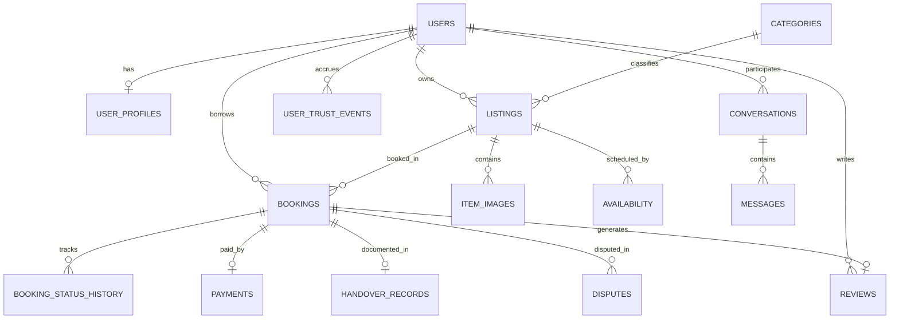

# BorrowCircle — System Architecture

**Tagline**: *Own Less. Access More.*  
**Primary Market**: India (INR ₹, PostGIS geo-discovery, Razorpay, Dual-OTP Handover)

---

## 1. High-Level Architecture Overview

BorrowCircle is structured around a **modular clean architecture backend (FastAPI)**, an **interactive cross-platform mobile client (Flutter/Dart)**, an **Admin Web Console**, and an **independent AIML Service layer** backed by PostgreSQL (PostGIS + pgvector), Redis, and Object Storage.



---

## 2. Component Breakdown

### 2.1 Mobile Application (Flutter)
- **Framework**: Flutter 3.x with Dart.
- **State Management**: BLoC / Cubit or Riverpod with clear separation between UI, Domain (Use Cases), and Data (Repositories).
- **Navigation**: Declarative routing (`go_router`) with auth guard and deep-linking support.
- **Offline / Caching**: `flutter_secure_storage` for tokens, Hive / SQLite for cached listings.
- **Geospatial**: `geolocator` with privacy fuzzing. Falls back to manual pincode/city picker.

### 2.2 Backend Application (FastAPI)
- **Framework**: FastAPI (Python 3.11+).
- **Architecture**: Layered Domain-Driven Design (API Routers $\to$ Service Layer $\to$ Repository / DAO $\to$ SQLAlchemy ORM).
- **Validation**: Pydantic v2 schemas for strict serialization and deserialization.
- **Concurrency**: Asynchronous routes (`async def`) for I/O-bound operations (DB, Redis, S3).
- **Task Execution**: Background tasks / Celery for heavy AI inference and push notifications.

### 2.3 AIML Services Architecture
The ML tier operates as modular services to keep latency predictable:
1. **Item Recognition**: Pre-trained YOLOv8 / MobileNet model classifies images, identifies categories, and infers tags.
2. **Semantic Search**: Text parsed using `all-MiniLM-L6-v2` generating 384-d vectors, matched via Cosine Distance in `pgvector` alongside PostGIS spatial distance filtering:
   $$\text{Score} = \alpha \cdot \text{Similarity}_{\text{vector}} + \beta \cdot (1 - \frac{\text{Distance}}{\text{MaxRadius}}) + \gamma \cdot \text{Rating}$$
3. **Smart Pricing**: Feature vector $(\text{category}, \text{replacement\_value}, \text{condition}, \text{locality\_demand})$ fed to an XGBoost model, returning recommended daily/weekly rates with lower/upper confidence bounds.
4. **Image Damage Inspector**: Handover vs Return image alignment, contour difference masking, and SSIM (Structural Similarity Index) to highlight discrepancies for human moderation.
5. **Anomaly & Fraud Detection**: User activity frequency, dispute velocity, cancellation spikes, and multi-account signals evaluated by an Isolation Forest model.

---

## 3. Booking Lifecycle State Machine

The core transactional reliability of BorrowCircle relies on an atomic, strictly validated state machine preventing double-booking and payment inconsistency:



---

## 4. Database Architecture & Relationships

PostgreSQL schema organized into modular domains:



### Key Data Entities
- **Users & Auth**: `id, phone, email, hashed_password, role, is_verified, trust_score, created_at`
- **UserProfiles**: `user_id, full_name, avatar_url, bio, address_city, geo_point (GEOMETRY(Point, 4326)), kyc_status`
- **Listings**: `id, owner_id, category_id, title, description, condition, replacement_value, daily_price, deposit_amount, location_geom, address_approx, is_active, embedding (VECTOR(384))`
- **Bookings**: `id, listing_id, borrower_id, start_date, end_date, total_days, rent_amount, deposit_amount, status, handover_otp, return_otp`
- **Payments**: `id, booking_id, razorpay_order_id, razorpay_payment_id, amount, deposit_amount, status, escrow_status`
- **HandoverRecords**: `id, booking_id, type (HANDOVER/RETURN), verified_by_otp, photos, damage_flag, damage_notes`

---

## 5. Security & Trust Architecture

1. **Location Privacy**:
   - Exact latitude/longitude is fuzzed by a randomized 200–500m radius buffer on public listing APIs.
   - Exact pickup address is disclosed to the borrower **only** after the booking transitions to `CONFIRMED`.
2. **Dual-OTP Handover System**:
   - Secure 6-digit OTP generated by backend on booking confirmation.
   - **Handover**: Borrower gives Handover OTP to Lender $\to$ Lender submits to backend $\to$ State advances to `ACTIVE`.
   - **Return**: Lender gives Return OTP to Borrower $\to$ Borrower submits to backend $\to$ State advances to `COMPLETED` $\to$ Triggers automated refund of security deposit.
3. **Payment Integrity**:
   - Client never directly modifies booking state to `CONFIRMED`.
   - Only HMAC-SHA256 verified webhooks from Razorpay trigger payment confirmation and booking state promotion.
4. **Role-Based Access Control (RBAC)**:
   - Scopes: `borrower`, `lender`, `admin`.
   - Admin routes require verified admin claims and audit log entry insertion.

---

## 6. Directory Structure & Code Organization

```
borrowcircle/
├── ARCHITECTURE.md                  # This specification
├── PROJECT_STATUS.md                # Milestone & live tracking
├── API_DOCUMENTATION.md             # REST & WebSocket contract
├── TODO.md                          # Prioritized roadmap
├── CHANGELOG.md                     # Revision log
├── backend/                         # FastAPI Application
│   ├── app/
│   │   ├── main.py                  # App entry point
│   │   ├── core/                    # Config, security, database session
│   │   ├── models/                  # SQLAlchemy ORM models
│   │   ├── schemas/                 # Pydantic request/response models
│   │   ├── api/v1/                  # API routers (auth, listings, bookings, etc.)
│   │   ├── services/                # Business logic & state machines
│   │   ├── ml/                      # AIML modules (YOLO, pricing, semantic, damage)
│   │   └── utils/                   # Helpers, OTP, geo calculations
│   ├── tests/                       # Pytest test suites
│   ├── alembic/                     # Database migrations
│   └── requirements.txt
├── mobile/                          # Flutter Mobile Application
│   ├── lib/
│   │   ├── main.dart
│   │   ├── core/                    # Theme, routing, network client
│   │   ├── features/                # Domain-centric feature modules
│   │   │   ├── auth/
│   │   │   ├── listings/
│   │   │   ├── bookings/
│   │   │   ├── chat/
│   │   │   └── profile/
│   │   └── shared/                  # Reusable UI components
│   └── pubspec.yaml
└── docker-compose.yml               # Local stack (Postgres/PostGIS/pgvector, Redis, API)
```
