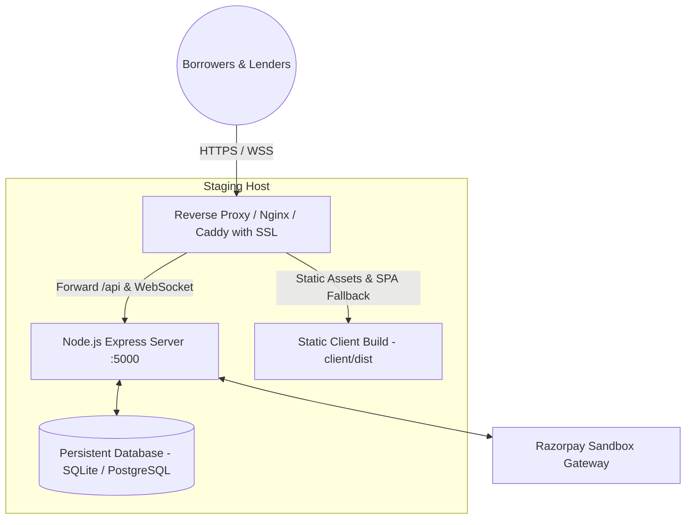

# BorrowCircle — Staging Deployment Guide

This guide describes how to deploy BorrowCircle to a staging environment for live end-to-end testing, partner demonstrations, and user acceptance testing prior to production release.

---

## 1. Architecture Overview

BorrowCircle can be deployed in one of two staging architectures:

1. **Unified Monolith Architecture (Recommended for Staging):**
   - Single Node.js instance (Render, Railway, Fly.io, or Ubuntu VPS).
   - Express backend serves both the `/api` REST endpoints, WebSockets (`socket.io`), and static frontend assets (`client/dist`) via single-port routing with SPA fallback.
   - SQLite persistent volume (e.g., `/data/borrowcircle.db`) or managed PostgreSQL.

2. **Decoupled Architecture:**
   - **Frontend:** Vercel, Netlify, or Cloudflare Pages (static SPA).
   - **Backend:** Railway, Render, Fly.io, or AWS EC2 (Node.js API + WebSockets).
   - **Database:** Managed PostgreSQL (Neon, Supabase, Railway, AWS RDS).



---

## 2. Server Prerequisites

- **Node.js:** v20.x or v22.x LTS
- **npm:** v10.x or higher
- **Git:** Installed on target host
- **Memory:** Minimum 1 GB RAM (2 GB recommended for building client)
- **Disk:** Minimum 5 GB persistent SSD storage

---

## 3. Step-by-Step Staging Deployment Instructions

### Option A: Deploying on a Cloud PaaS (Railway / Render / Fly.io)

1. **Connect Repository:**
   Link your GitHub repository to your PaaS project.

2. **Configure Build & Start Commands:**
   - **Root Directory:** Repository root
   - **Build Command:**
     ```bash
     cd server && npm install && npx prisma generate && npx tsc && cd ../client && npm install && npm run build
     ```
   - **Start Command:**
     ```bash
     cd server && node dist/index.js
     ```

3. **Configure Environment Variables:**
   Add variables from `PRODUCTION_ENVIRONMENT_TEMPLATE.md` in your PaaS dashboard:
   - `NODE_ENV=staging`
   - `PORT=5000` (or dynamically mapped by PaaS)
   - `JWT_SECRET=<generated-64-char-secret>`
   - `DATABASE_URL=file:/data/borrowcircle.db` (if using mounted volume) OR your PostgreSQL connection URL
   - `RAZORPAY_KEY_ID=<your-rzp-test-key-id>`
   - `RAZORPAY_KEY_SECRET=<your-rzp-test-key-secret>`
   - `RAZORPAY_WEBHOOK_SECRET=bc_webhook_secret_staging_2026`
   - `ADMIN_EMAIL=admin@borrowcircle.in`
   - `ADMIN_PASSWORD=<secure-staging-password>`

4. **Initialize Database:**
   In the service console:
   ```bash
   cd server
   npx prisma db push
   # Optional: Seed initial categories and catalog
   npm run seed
   ```

---

### Option B: Deploying on a Linux Virtual Server (Ubuntu 22.04 / 24.04 LTS)

#### Step 1: Install Node.js & Process Manager
```bash
# Update system
sudo apt update && sudo apt upgrade -y

# Install Node.js 22 LTS
curl -fsSL https://deb.nodesource.com/setup_22.x | sudo -E bash -
sudo apt install -y nodejs git build-essential

# Install PM2 Process Manager
sudo npm install -g pm2
```

#### Step 2: Clone & Build Application
```bash
# Clone to /var/www/borrowcircle
sudo mkdir -p /var/www/borrowcircle
sudo chown -R $USER:$USER /var/www/borrowcircle
git clone <your-git-repo-url> /var/www/borrowcircle
cd /var/www/borrowcircle

# Install server dependencies and compile TypeScript
cd server
npm install --production=false
npx prisma generate
npx tsc

# Install client dependencies and compile Vite bundle
cd ../client
npm install
npm run build
cd ..
```

#### Step 3: Configure Environment Variables
Create `/var/www/borrowcircle/server/.env`:
```env
PORT=5000
NODE_ENV=staging
CORS_ORIGIN=*
DATABASE_URL="file:./staging.db"
JWT_SECRET=generate_strong_secret_using_openssl
RAZORPAY_KEY_ID=rzp_test_xxxxxxxxxxxxxxxx
RAZORPAY_KEY_SECRET=xxxxxxxxxxxxxxxxxxxxxxxx
RAZORPAY_WEBHOOK_SECRET=bc_webhook_secret_staging_2026
ADMIN_EMAIL=admin@borrowcircle.in
ADMIN_PASSWORD=SetAStrongPassword2026!
DEFAULT_LENDER_COMMISSION=15
DEFAULT_RECEIVER_COMMISSION=15
DEFAULT_INSPECTION_MINUTES=15
```

#### Step 4: Run Database Migrations
```bash
cd /var/www/borrowcircle/server
npx prisma db push
# Seed default neighborhood data
npm run seed
```

#### Step 5: Start Service with PM2
```bash
cd /var/www/borrowcircle/server
pm2 start dist/index.js --name "borrowcircle-staging" --time
pm2 save
pm2 startup
```

#### Step 6: Configure Nginx & SSL (Let's Encrypt)
Create `/etc/nginx/sites-available/borrowcircle-staging`:
```nginx
server {
    server_name staging.borrowcircle.in;

    location / {
        proxy_pass http://localhost:5000;
        proxy_http_version 1.1;
        
        # WebSocket support
        proxy_set_header Upgrade $http_upgrade;
        proxy_set_header Connection "upgrade";
        
        proxy_set_header Host $host;
        proxy_set_header X-Real-IP $remote_addr;
        proxy_set_header X-Forwarded-For $proxy_add_x_forwarded_for;
        proxy_set_header X-Forwarded-Proto $scheme;
        
        proxy_read_timeout 86400s;
        proxy_send_timeout 86400s;
    }

    client_max_body_size 10M;
}
```

Enable site and provision SSL:
```bash
sudo ln -s /etc/nginx/sites-available/borrowcircle-staging /etc/nginx/sites-enabled/
sudo nginx -t
sudo systemctl reload nginx
sudo certbot --nginx -d staging.borrowcircle.in
```

---

## 4. Staging Health Verification

Test the deployed staging environment:
```bash
# 1. Health check
curl -I https://staging.borrowcircle.in/api/health

# Expected response:
# HTTP/2 200
# content-type: application/json; charset=utf-8
# {"status":"ONLINE","service":"BorrowCircle Hyperlocal API", ...}

# 2. Check Client Index & SPA fallback
curl -I https://staging.borrowcircle.in/explore
# Expected response: HTTP/2 200 (serving index.html)
```
